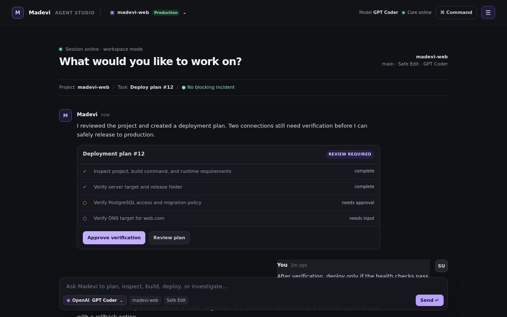

# Madevi Harness

Madevi Harness is an open-source, self-hosted agent harness for three connected jobs:

- **Workspace** — plan, inspect, edit, test, and automate project work.
- **Deploy** — verify infrastructure, release projects, validate health, and roll back safely.
- **Monitor Control** — optional low-cost server monitoring, incident handling, and scheduled audits.

It is being rebuilt around one shared runtime. CLI, Visual Mode, Telegram, and Madevi Assist call the same action contracts, policy engine, state, and audit trail. They are interfaces and first-party modules of one harness—not separate products.

> Status: early foundation. The CLI in this repository is dependency-free and safe by default; it does not execute project code or server actions yet.

## Visual Mode preview

Visual Mode is chat-first: the active task and approval flow stay in the workspace, while project, model, deploy, monitor, assistant, and security controls live in the right-side control panel. The current preview is being replaced by a daemon-backed interface.

## Runtime rebuild

The repository is progressing through a public, tested rebuild from the starter into a durable agent harness. Read the [harness definition](docs/harness.md), [architecture](docs/architecture-v2.md), [source benchmark](docs/reference-benchmark.md), and [release plan](docs/release-plan.md) before relying on a future capability.

## Quick start

Requires Node.js 20 or newer.

~~~
git clone https://github.com/Madevi810/Madevi-Agent.git
cd Madevi-Agent
npm run cli -- init
npm run cli -- status
npm run cli -- daemon start
npm run cli -- daemon url
~~~

### One-command install

For Linux and macOS with Git and Node.js 20 or newer:

~~~
curl -fsSL https://raw.githubusercontent.com/Madevi810/Madevi-Agent/main/scripts/install.sh | bash
~~~

The installer uses ~/.local/share/madevi, creates ~/.local/bin/madevi, preserves an installation with uncommitted changes, and never uses sudo. If ~/.local/bin is not on PATH, it prints the one-line PATH command to add.

Useful starter commands:

~~~
npm run cli -- model list
npm run cli -- model use gpt-coder
npm run cli -- model add team-model Acme "Team Code Model"
npm run cli -- model connect team-model https://provider.example/v1 model-name MADEVI_MODEL_API_KEY
npm run cli -- auth status
npm run cli -- project create "madevi-web"
npm run cli -- project use project-1
npm run cli -- session start "Prepare release"
npm run cli -- agent start "Plan authentication"
npm run cli -- agent mode session-1 plan
npm run cli -- agent send session-1 "Analyze the current auth design"
npm run cli -- monitor on
npm run cli -- monitor status
npm run cli -- monitor check
npm run cli -- monitor incidents
npm run cli -- task create "Inspect deployment logs"
npm run cli -- plan list
npm run cli -- plan approve plan-1
npm run cli -- audit
npm run cli -- action show deploy.release
~~~

Configuration is stored locally in ~/.madevi/config.json. Set MADEVI_HOME to use a different directory.

Madevi starts with no active AI model. Select a configured profile explicitly with `model use`, or add custom provider metadata with `model add`. API keys are deliberately excluded from configuration; inject them through an OS keychain, vault, or environment provider.

### Local control endpoint

`madevi daemon start` starts the early Madevi Harness Core service on `http://127.0.0.1:8787`. It is loopback-only and currently exposes read-only health, status, action-manifest, and module-manifest endpoints. Visual Mode is a client of this service.

## Repository map

~~~
apps/cli/          Command-line interface
apps/studio/       Legacy static preview; replaced by Visual Mode during the rebuild
packages/contracts/ Shared action contracts for every Madevi interface
packages/core/     Harness configuration, daemon, module registry, and runtime state
packages/policy/   Risk tiers and approval rules
services/monitor/  Token-free system snapshot sentinel
docs/              Architecture notes
~~~

## Safety model

- Monitoring is disabled until explicitly enabled.
- The token-free sentinel can create incidents from deterministic host thresholds; it never remediates a server on its own in this starter.
- The default policy is read-only / safe-edit; destructive server actions are not implemented in the starter.
- Future tools must declare risk, required permission, approval rule, verification, and rollback behavior.
- Secrets belong in a vault provider, never in Telegram chat or repository files.

## License and brand

Madevi Harness uses Apache-2.0. The Madevi name and logo are not granted by that code license; publish a trademark policy before authorizing branded forks or commercial distributions.
